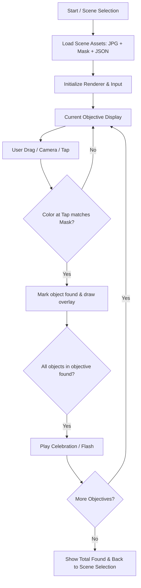
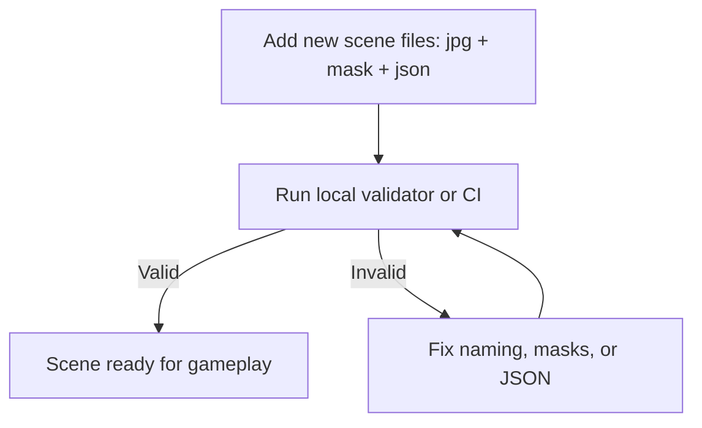

# 🦁 Wildlife Photo / Wimmelbild Game

**Project goal:**
A tablet-friendly _photo hunt game_ for children (2–6), now extensible to “wimmelbild”-style tasks: find objects like animals, planes, or other items. Supports real photos or illustrations.

Players **pan/drag** or use a stylus to find objects in a scene and tap/click to capture them.

---

## 🗂️ Project Structure

```
.
├── index.html
├── style.css
├── src/
│   ├── main.ts
│   ├── sceneRenderer.ts
│   ├── scene.ts
│   ├── config.ts
│   └── input.ts
├── scripts/               # compiled JS output
├── assets/
│   ├── objects/*.svg
│   ├── backgrounds/*.svg or .jpg
│   └── icons/*.svg
├── scenes/
│   ├── scene_name.jpg      # full scene
│   ├── scene_name_mask.png # color-coded object positions
│   └── scene_name.json     # scene definition
├── tests/                 # jest / cypress tests
├── package.json
├── tsconfig.json
└── .github/workflows/
```

---

## ⚙️ Scene Naming Conventions

- **Base name** of scene files (jpg, png, json) must match exactly.
- **File suffixes**:

  - `.jpg` → panorama / illustration
  - `_mask.png` → color-coded overlay
  - `.json` → scene definition

- **Example**:

  ```
  jungle_adventure.jpg
  jungle_adventure_mask.png
  jungle_adventure.json
  ```

- **Identifiers** for objects are **unique names**:

  - elephant1, elephant2, lion1
  - Avoid duplicates; any type of object (planes, trees, toys…) is allowed.

- The validator checks for:

  - Missing masks or JSON
  - Duplicate object identifiers
  - Scene image & mask dimension mismatches

---

## 📝 Scene JSON Structure

```json
{
  "name": "jungle_adventure",
  "sceneType": "wimmelbild", // or "photo"
  "objects": [
    {
      "name": "elephant1",
      "color": "#ff0000",
      "tags": ["elephant"],
      "found": false
    },
    { "name": "lion1", "color": "#00ff00", "tags": ["lion"], "found": false }
  ],
  "objectives": [
    { "title": "Find all 🐘", "tags": ["elephant"], "emoji": "🐘" },
    { "title": "Find all 🦁", "tags": ["lion"], "emoji": "🦁" }
  ]
}
```

> **Note:** `name` must be unique. `sceneType` selects interaction mode: "photo" for camera-style capture, "wimmelbild" for direct object clicks. `color` must match the mask PNG color for that object.

---

## 🎮 Game Flow



---

## 🛠️ Developer Notes

- Modular TS code: `SceneRenderer`, `Scene`, `Input`, `Config`.
- **Mask-based detection**: allows using any image / illustration without hardcoding positions.
- Supports multiple sequential objectives in the same scene.
- Unique object IDs allow grouping and tracking progress.
- Camera / drag mechanics fully abstracted from scene content.

---

## ✅ Scene Validation Workflow



**Example GitHub Action:**

```yaml
name: Validate Scenes

on:
  push:
    branches:
      - main
  pull_request:

jobs:
  validate-scenes:
    runs-on: ubuntu-latest
    steps:
      - uses: actions/checkout@v4
      - uses: actions/setup-node@v4
        with:
          node-version: 20
      - run: npm install --include=dev
      - run: npm run validate:scenes
```

- Validator is **read-only**, fails CI if any scene is invalid.
- Can be executed locally:

  ```bash
  npm run validate:scenes
  ```

---

## 📦 Developer Quick Start

```bash
npm install
npm run build # generates assets/scenes/scenes-manifest.json + compiles src/ → scripts/
npm run serve # local static server on http://127.0.0.1:8090
```

- `npm run serve` is a **local development convenience only** — browsers block
  `fetch()` against `file://` URLs, so the game must be served over HTTP
  locally. In production no Node process runs anywhere: GitHub Pages serves the
  static files built by CI.
- Open on tablet: `http://<local-ip>:8090`
- `scripts/` and `assets/scenes/scenes-manifest.json` are **generated, not
  committed** (gitignored). Run `npm run build` after cloning or after changing
  `src/` or scene files.
- CI/CD (`deploy.yml`) builds from source on every push to `main` and publishes
  the runtime files to the `gh-pages` branch, which GitHub Pages serves.

### Quick setup for Volta on Ubuntu

```bash
# remove old nodejs/npm
sudo apt remove nodejs npm -y

# install volta
curl https://get.volta.sh | bash
exec $SHELL

# install node (latest LTS)
volta install node

# verify
node -v
npm -v
```

---

## 💡 Extending to Wimmelbilder

- Any type of object can be added: planes, toys, soccer balls, etc.
- Tasks are just **objective groups** with tags.
- Mask image color codes track hits.
- Drag-to-find replaces camera if needed.
- Supports multiple sequential objectives in a single scene.
